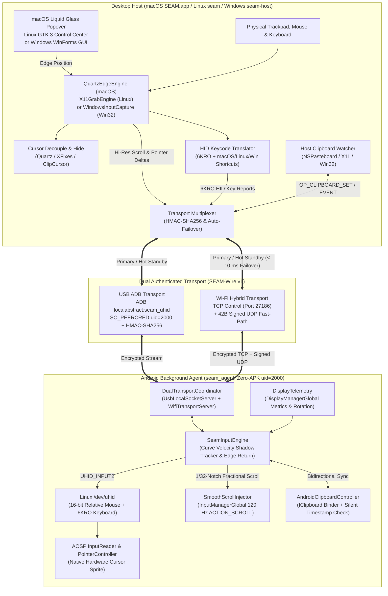

<div align="center">


<h1>SEAM</h1>

<p align="center">
  <strong>One cursor. Every screen.</strong><br/>
  Seamless, non-root mouse, keyboard, smooth scrolling, and clipboard sharing between <strong>macOS</strong>, <strong>Linux</strong>, <strong>Windows</strong>, and <strong>Android</strong>.
</p>

<p align="center">
  <a href="https://github.com/Ferousco-dev/Seam/releases/download/v1.1.0/SEAM-macOS-arm64.dmg"></a>
  &nbsp;
  <a href="https://github.com/Ferousco-dev/Seam/releases/latest"></a>
  &nbsp;
  <a href="https://github.com/Ferousco-dev/Seam/releases/download/v1.1.0/SEAM-Setup-x64.exe"></a>
</p>

<p align="center">
  
  
  
  
  
  
  
  
  <a href="CONTRIBUTING.md"></a>
  <a href="LICENSE"></a>
</p>

<p align="center">
  <a href="#what-is-seam">What is SEAM</a> •
  <a href="#preview">Preview</a> •
  <a href="#install">Install</a> •
  <a href="#technology-stack">Technology Stack</a> •
  <a href="#how-it-works">How It Works</a> •
  <a href="#build-from-source">Build from Source</a> •
  <a href="#contributing">Contributing</a>
</p>

</div>

---

## What is SEAM?

**SEAM** brings an Apple Universal Control experience to **macOS, Linux, Windows, and Android**.

Move your desktop cursor past the edge of your display and it flows directly onto your Android phone sitting beside your computer. Unlike screen-mirroring tools (`scrcpy`) that trap your pointer inside a desktop video window, or accessibility-based apps that draw fake overlay cursors, SEAM registers real virtual hardware HID devices in Android's Linux kernel (`/dev/uhid`) without root. You get Android's genuine native hardware pointer, 120 Hz smooth scrolling, desktop keyboard shortcuts, and automatic bidirectional clipboard sync over USB or Wi-Fi, from a native macOS menu-bar app, a Linux GTK 3 Control Center & CLI, or a native Windows desktop application, with no Android app to install.

---

## Preview

<div align="center">
  <table>
    <tr>
      <td align="center" width="54%">
        
        <br/><br/>
        <sub><strong>macOS Menu-Bar Popover:</strong> Liquid Glass UI &amp; drag-to-arrange display layout (<a href="assets/seam-demo.mp4">MP4</a> · <a href="assets/seam-demo.mov">MOV</a>)</sub>
      </td>
      <td align="center" width="46%">
        
        <br/><br/>
        <sub><strong>Android Screen:</strong> Genuine native hardware cursor sprite driven via <code>/dev/uhid</code> (no root, no screen mirroring)</sub>
      </td>
    </tr>
  </table>
  <br/>
  <video src="assets/seam-demo.mp4" width="520" controls autoplay loop muted playsinline></video>
</div>

---

## Install

### 1. macOS Setup
1. Download **[SEAM-macOS-arm64.dmg](https://github.com/Ferousco-dev/Seam/releases/download/v1.1.0/SEAM-macOS-arm64.dmg)** (or **[SEAM-macOS-arm64.zip](https://github.com/Ferousco-dev/Seam/releases/download/v1.1.0/SEAM-macOS-arm64.zip)**) from the [latest GitHub Release](https://github.com/Ferousco-dev/Seam/releases/latest).
2. Open the disk image and drag **SEAM** into **Applications**.
3. On first launch, right-click **SEAM.app** → **Open** (builds are ad-hoc signed, not notarized with an Apple Developer ID).
4. Look for the **laptop & iPhone** icon in your macOS menu bar.

### 2. Linux Setup (X11 / XWayland)
1. **Debian, Ubuntu, or Linux Mint (`.deb`):** Download **[seam_1.1.0_amd64.deb](https://github.com/Ferousco-dev/Seam/releases/download/v1.1.0/seam_1.1.0_amd64.deb)** from the [latest GitHub Release](https://github.com/Ferousco-dev/Seam/releases/latest) and install it:
   ```bash
   sudo apt install ./seam_1.1.0_amd64.deb
   ```
2. **Any Linux distro (rootless `.tar.gz`):** Download **[seam-1.1.0-linux-x86_64.tar.gz](https://github.com/Ferousco-dev/Seam/releases/download/v1.1.0/seam-1.1.0-linux-x86_64.tar.gz)**, extract it, and run `./install.sh` (installs to `~/.local` with desktop launcher & icon, no `sudo` needed).
3. Make sure `adb` (`android-tools-adb` / `platform-tools`) is on your `PATH`, then launch **SEAM Control Center** from your app menu or run:
   ```bash
   seam app                     # GTK 3 Control Center
   seam connect --edge right    # Headless screen-edge session
   ```

### 3. Windows Setup (Windows 10 / 11 x64)
1. **Installer (Recommended):** Download **[SEAM-Setup-x64.exe](https://github.com/Ferousco-dev/Seam/releases/download/v1.1.0/SEAM-Setup-x64.exe)** from the [latest GitHub Release](https://github.com/Ferousco-dev/Seam/releases/latest), run the installer, and launch **SEAM** from the Start Menu. (Windows SmartScreen will prompt because builds are unsigned: click **More info → Run anyway**).
2. **Portable ZIP:** Download **[SEAM-Windows-x64.zip](https://github.com/Ferousco-dev/Seam/releases/download/v1.1.0/SEAM-Windows-x64.zip)**, unzip anywhere, and run `seam-host.exe`.
3. SEAM for Windows bundles the host, .NET runtime, Android agent, and ADB platform-tools. No external dependencies required.

### 4. Android Setup (Automatic, Zero APK)
1. Enable **USB Debugging** (or **Wireless Debugging**) once under Android **Developer Options**.
2. Plug your phone in for a moment (or connect via Wireless Debugging). **SEAM** automatically pushes the `32 KB` `seam-agent.jar` agent, starts the `/dev/uhid` virtual mouse & keyboard, and attaches both **USB** and **Wi-Fi** links.
3. Unplug anytime: the background daemon keeps Wi-Fi (`TCP/UDP 27186`) ready for cable-free reconnection.
4. *(macOS Optional)* Grant **SEAM** permission in **System Settings → Privacy & Security → Accessibility** to enable global `CGEventTap` capture alongside the built-in non-activating panel fallback.

### Controls & Shortcuts
- **Edge Crossing:** Move your pointer past the side where you positioned your phone. Drag either tile inside the macOS popover, Linux Control Center, or Windows GUI to match your desk.
- **Desktop Shortcuts on Android:** On macOS, `Cmd+C` / `Cmd+V` / `Cmd+X` / `Cmd+A` / `Cmd+Z`, `Cmd+Left/Right` (line start/end), `Cmd+Up/Down` (document top/bottom), `Opt+Left/Right` (word jump), and `Opt+Backspace` (delete word) translate cleanly to Android. On Linux and Windows, standard `Ctrl` and `Alt` shortcuts pass straight through.
- **Emergency Return to Desktop:** **`Ctrl + Option + Q`** or **`Ctrl + Option + Cmd + Esc`** on macOS; **`Ctrl + Alt + Q`** on Linux and Windows.

---

## Technology Stack

| Icon | Technology | Role in SEAM |
|:---:|---|---|
|  | **Swift 6** | Native macOS host daemon, wire protocol serializer, hotkey & shortcut translator |
|  | **SwiftUI & Apple Liquid Glass** | macOS menu-bar popover (`GlassEffectContainer`, `.glassEffect`, `.buttonStyle(.glass)` on macOS 26+ with vibrancy fallback) and interactive `ArrangementView` |
|  | **AppKit & Quartz Event Services** | `NSStatusBar`, `CGEventTap`, `CGAssociateMouseAndMouseCursorPosition`, and non-activating `CaptureShieldPanel` (`NSPanel`) |
|  | **Rust + X11 / GTK 3** | Native Linux host (`linux-host/`), X11 pointer/keyboard grab & XFixes cursor hiding, X11 clipboard sync, and GTK 3 Control Center |
|  | **C# + .NET 8 / WinForms** | Native Windows host (`windows-host/`), graphite dark GUI with Home/Activity/Settings/Diagnostics navigation rail, Win32 input capture hooks, and Inno Setup installer |
|  | **Java 17 + Android SDK `d8`** | Zero-Gradle `32 KB` DEX daemon (`dist/seam-agent.jar`) launched via `app_process` (`uid=2000`) |
|  | **Linux Kernel `/dev/uhid`** | Registers a 16-bit relative HID Mouse and 6KRO HID Keyboard (`UHID_CREATE2` / `UHID_INPUT2`) directly with `InputReader` |
|  | **Android `InputManagerGlobal` & `IClipboard`** | Injects 120 Hz fractional `MotionEvent.ACTION_SCROLL` events and syncs system clipboard changes via silent timestamp inspection |
|  | **CryptoKit, Rust `hmac`/`sha2`, C# `HMACSHA256` & `javax.crypto`** | Mutual HMAC-SHA256 session handshake (`SEAM-Wire v1`) and authenticated 42-byte UDP mouse delta datagrams |
|  | **ADB Socket + Hybrid TCP/UDP** | Concurrent USB (`localabstract:seam_uhid`) & Wi-Fi (`TCP/UDP 27186`) multiplexer with automatic cable-pull failover |

---

## How It Works

### System Architecture



### What Happens When Your Cursor Crosses Over

```mermaid
sequenceDiagram
    autonumber
    participant Desktop as Desktop Host (macOS / Linux / Windows)
    participant Link as USB / Wi-Fi (SEAM-Wire v1)
    participant Phone as Android Agent (seam_agent)
    participant OS as Android Kernel & System

    Desktop->>Link: Mutual HMAC-SHA256 Handshake
    Link->>Phone: Authenticate Session (USB + Wi-Fi Standby)
    Phone-->>Desktop: OP_DISPLAY_INFO (Resolution, DPI, Rotation)

    Note over Desktop,Phone: You move your pointer past the configured screen edge
    Desktop->>Desktop: Decouple & hide desktop cursor (no warp bounce)
    Desktop->>Link: OP_CURSOR_ENTER + OP_CLIPBOARD_SET (sync host clipboard)
    Link->>Phone: Home pointer & update Android IClipboard
    Phone->>OS: /dev/uhid mouse report + IClipboard.setPrimaryClip

    loop Active Control on Android (120 Hz)
        Desktop->>Link: Mouse Deltas & Scroll (42B Signed UDP / USB)
        Link->>Phone: Deliver Input Frame
        Phone->>OS: /dev/uhid Pointer Sprite + SmoothScrollInjector ACTION_SCROLL
        Desktop->>Link: Keyboard Reports (6KRO HID + Shortcut Translation)
        Phone->>OS: /dev/uhid 6KRO Key Report
    end

    Note over Phone,OS: Copy on Android or push pointer back to the return bezel
    OS-->>Phone: IOnPrimaryClipChangedListener -> OP_CLIPBOARD_EVENT
    Phone-->>Desktop: Sync copied text to Host Clipboard
    Phone-->>Desktop: OP_EDGE_RETURN (exit Y ratio)
    Desktop->>Desktop: Restore & show desktop cursor at matching edge height
```

### Repository Structure

```text
SEAM/
├── README.md
├── CONTRIBUTING.md
├── LICENSE
├── Makefile
├── .github/
│   ├── scripts/                      # Windows CI execution & GUI lifecycle test scripts
│   └── workflows/
│       ├── release.yml               # Linux CI (cargo test) + .deb/.tar.gz release publisher
│       └── windows-build.yml         # Windows CI (.NET 8, self-test, installer & ZIP packager)
├── assets/
│   ├── app-icon.png                  # Exported 1024×1024 Icon Composer AppIcon
│   ├── android-native-cursor.jpg     # Native Android hardware pointer screenshot
│   ├── seam-demo.gif                 # Animated demo preview
│   ├── seam-demo.mp4                 # 60 fps H.264 demo clip
│   ├── seam-demo.mov                 # Original screen recording
│   ├── social-preview.png            # 1280×640 GitHub social preview card
│   ├── download-macos.svg
│   ├── download-linux.svg
│   └── download-windows.svg
├── release/
│   ├── SEAM-macOS-arm64.dmg          # Ready-to-install macOS disk image (bundles Android agent)
│   └── SEAM-macOS-arm64.zip          # Portable zipped SEAM.app bundle
├── scripts/
│   ├── build-agent.sh                # Zero-Gradle DEX compiler (javac + Android SDK d8)
│   ├── build-host.sh                 # Swift release build, Icon Composer export & SEAM.app bundler
│   ├── install-linux.sh              # Rootless Linux builder & ~/.local installer
│   └── package-linux.sh              # Linux .tar.gz and .deb release packager
├── macos-host/
│   ├── Package.swift
│   ├── Resources/AppIcon.icon/       # Apple Icon Composer document (laptopcomputer.and.iphone)
│   └── Sources/SeamHost/
│       ├── Main.swift                # App & CLI entrypoint (app, edge, devices, usb/wifi/switch tests)
│       ├── UI/                       # SeamMenuBarController, SeamPopoverView, ArrangementView, LiquidGlass, SeamAppViewModel
│       ├── Input/                    # QuartzEdgeEngine, BackgroundCursorController, MacKeycodeTranslator, MacClipboardSyncEngine
│       ├── Protocol/                 # SeamWireProtocol & CryptoKit SeamAuthenticator
│       ├── Transport/                # SeamTransport, UsbAdbTransport, WifiHybridTransport & SeamTransportMultiplexer
│       └── Bootstrap/                # UsbBootstrapper (ADB / Wireless Debugging / mDNS / LAN probe)
├── linux-host/
│   ├── Cargo.toml
│   ├── src/
│   │   ├── main.rs                   # CLI & GUI entrypoint (app, connect, devices, info)
│   │   ├── protocol/                 # SEAM-Wire v1 codec & HMAC-SHA256 authenticator
│   │   ├── transport/                # USB ADB socket, Wi-Fi TCP/UDP fast-path & multiplexer
│   │   ├── bootstrap/                # ADB device discovery, agent push & Wi-Fi probe
│   │   ├── input/                    # X11 edge watcher, pointer/keyboard grab, X11 keymap & clipboard
│   │   ├── session/                  # Active session coordinator & edge return handling
│   │   └── ui/                       # GTK 3 Control Center & interactive arrangement view
│   └── tests/                        # Protocol, keymap, input, transport & session test suites
├── windows-host/
│   ├── Seam.WindowsHost.csproj       # .NET 8 Windows Forms project
│   ├── Program.cs                    # Desktop app & CLI entrypoint
│   ├── Gui/                          # MainForm, NavRail, ArrangementPanel, DarkTitleBar, Theme
│   ├── Host/                         # SessionController, AppLayout, ConnectionDiagnosis, WirelessDiscovery
│   ├── Input/                        # WindowsInputCapture (low-level hooks & ClipCursor), WindowsKeyTable
│   ├── Protocol/                     # SeamWireProtocol, SeamAuthenticator, SeamFrames
│   ├── Transport/                    # SeamConnection (USB ADB socket + Wi-Fi TCP/UDP)
│   ├── installer/                    # SEAM.iss (Inno Setup 6 compiler script)
│   └── packaging/                    # Get-Adb.ps1, README-WINDOWS.txt, THIRD-PARTY-NOTICES.md, seam.ico
├── android-agent/
│   └── src/main/java/com/seam/agent/
│       ├── Main.java                 # Daemon & diagnostics CLI (--server, --info, --self-test, --calibrate)
│       ├── core/                     # SeamInputEngine
│       ├── clipboard/                # AndroidClipboardController
│       ├── pointer/                  # PointerLinearizer & SmoothScrollInjector
│       ├── protocol/                 # SeamProtocol & SeamAuthenticator
│       ├── transport/                # DualTransportCoordinator, UsbLocalSocketServer, WifiTransportServer
│       ├── uhid/                     # UhidDevice, HidDescriptors, HidKeycodes
│       └── telemetry/                # DisplayTelemetry, DisplayMetricsSnapshot, NetworkTelemetry
├── docs/                             # Architecture assessments, readiness reviews, and host guides
│   ├── WINDOWS-PORT-ASSESSMENT.md
│   ├── WINDOWS-READINESS-REVIEW.md
│   └── windows/                      # Windows install, verification & packaging docs
│       ├── README.md
│       ├── INSTALL.md
│       ├── MANUAL-VERIFICATION.md
│       └── THIRD-PARTY-NOTICES.md
├── tools/                            # Protocol conformance, golden vectors & Java parity verification
└── research/                         # Architecture specifications & protocol notes
```

---

## Build from Source

### macOS
- **Prerequisites:** macOS 14+ (Apple Silicon `arm64`) with **Xcode** (Swift 6+, `ictool`, `actool`), **JDK 17+**, and **Android SDK** (`adb`, `d8`, `platforms/android-35/android.jar` in `~/Library/Android/sdk`).
```bash
# Compile Android DEX agent (dist/seam-agent.jar), Swift host (dist/seam-host), and dist/SEAM.app
make build

# Launch SEAM in the macOS Menu Bar
open dist/SEAM.app
```

### Linux (X11 / XWayland)
- **Prerequisites:** Rust toolchain (`cargo`, `rustc`), `libx11-dev`, `libxfixes-dev`, `libgtk-3-dev`, `pkg-config`, `adb`, plus **JDK 17+** & **Android SDK** (`d8`, `android.jar`) if rebuilding `dist/seam-agent.jar`.
```bash
# Build dist/seam-agent.jar (if not already present)
./scripts/build-agent.sh

# Build & install rootless to ~/.local (includes desktop entry & icon)
./scripts/install-linux.sh

# Run Rust test suite
(cd linux-host && cargo test)

# Build .tar.gz and .deb release packages under build/release/
./scripts/package-linux.sh 1.1.0
```

### Windows (10 / 11 x64)
- **Prerequisites:** **.NET 8 SDK**, **Inno Setup 6** (optional, for installer packaging), plus **JDK 17+** & **Android SDK** if rebuilding `dist/seam-agent.jar`.
```bash
# Build Release executable
dotnet build windows-host/Seam.WindowsHost.csproj -c Release

# Run self-tests
dotnet run --project windows-host/Seam.WindowsHost.csproj -c Release -- --self-test

# Run protocol parity & OpenSSL golden vector verification
python3 tools/check_java_parity.py
python3 tools/verify_protocol.py
bash tools/verify_vectors_openssl.sh

# Launch SEAM Windows Desktop Application
dotnet run --project windows-host/Seam.WindowsHost.csproj -c Release
```

### Diagnostic & Transport Verification Targets (macOS)
```bash
make edge           # Terminal-based macOS <-> Android edge-crossing session
make devices        # List discovered Android devices
make usb-test       # Benchmark USB ADB socket transport & mutual auth
make wifi-test      # Benchmark Wi-Fi Hybrid (TCP + 42B HMAC-SHA256 UDP) transport
make switch-test    # Test live zero-downtime USB <-> Wi-Fi switching & failover
make device-info    # Inspect display geometry, /dev/uhid & PointerChoreographer
make self-test      # Run on-device /dev/uhid cursor & keyboard self-test
make calibrate      # Verify 16-bit corner homing & velocity control calibration
```

See [`research/README.md`](research/README.md) for deep technical specifications.

---

## Contributing

SEAM is open to pull requests, bug reports, and hardware compatibility feedback (testing across Android OEMs, Windows 10/11 multi-monitor edge routing, and Linux Wayland native capture). See **[CONTRIBUTING.md](CONTRIBUTING.md)** for setup steps, verification commands, and PR guidelines.

---

## License

Distributed under the **[MIT License](LICENSE)**.
